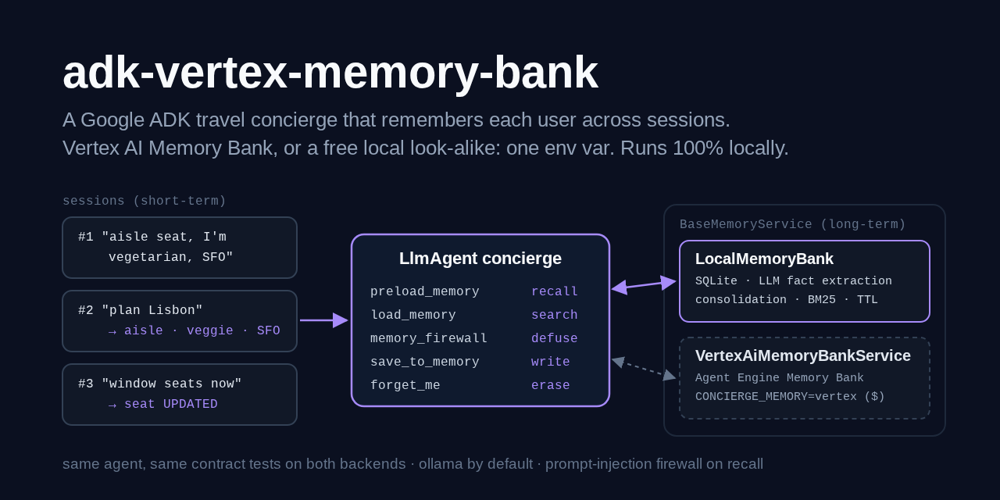
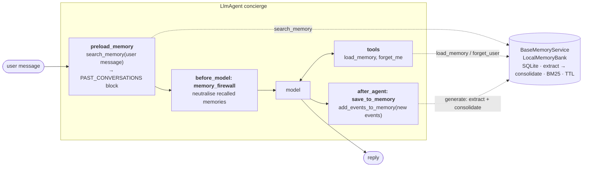

# adk-vertex-memory-bank

> Long-term agent memory in Google's [Agent Development Kit](https://adk.dev), built for
> **Vertex AI Agent Engine Memory Bank**: a **travel concierge** that learns each user's
> preferences in one conversation and uses them in the next. The agent depends only on
> ADK's `BaseMemoryService`; one environment variable picks
> `VertexAiMemoryBankService(project, location, agent_engine_id)` or `LocalMemoryBank`, an
> open-source look-alike in this repo (LLM fact extraction, consolidation, per-user scopes,
> BM25 recall, TTL, SQLite). `preload_memory` recalls, an `after_agent_callback` writes,
> `forget_me` erases, and one contract test suite proves both backends behave the same.

[](https://github.com/MartinCastroAlvarez/adk-vertex-memory-bank/actions/workflows/ci.yml)
[](LICENSE)
[](pyproject.toml)
[](https://pypi.org/project/google-adk/)
[](pyproject.toml)



**Runs 100% locally, no paid APIs required.** The concierge runs on an open-weight model
on [ollama](https://ollama.com) (`qwen3:4b`) through ADK's `LiteLlm`, and the same model
extracts memories into a SQLite file on your disk. Vertex AI Memory Bank is a paid Google
Cloud service: the adapter is real and follows the current SDK, but nothing in this repo
(tests, demo, CI) ever calls it. The tests run it against a fake client;
[docs/vertex-setup.md](docs/vertex-setup.md) shows how to point it at your own project.

## Why

- **Sessions forget, users don't.** An ADK session is one conversation. Anything worth
  keeping ("I'm vegetarian", "aisle seat", "I fly from SFO") has to be pulled out of it
  and stored per user, or the next conversation starts from zero.
- **Memory is extraction plus consolidation, not a transcript.** Memory Bank doesn't store
  chats; an LLM extracts facts under topics and merges them with what it already knows. If
  you change your mind about seats, the old fact gets *updated*. A store that only appends
  ends up recalling both.
- **The backend should be a deployment choice.** The agent here only knows
  `BaseMemoryService`. Develop on a laptop for free, switch to Memory Bank in production
  with `CONCIERGE_MEMORY=vertex`, and keep one test suite for both.
- **Recalled memory is untrusted input.** Whatever a user said months ago lands in today's
  prompt. A firewall callback neutralises recalled memories before every model call,
  whichever backend they came from.
- **Users can leave.** `forget_me` erases a user's scope, revisions included, and nothing
  from that conversation is written back.

## Quickstart

```bash
pip install "adk-vertex-memory-bank @ git+https://github.com/MartinCastroAlvarez/adk-vertex-memory-bank"
ollama pull qwen3:4b
python -m travel_concierge --user alice "I'm vegetarian and I always want an aisle seat."
python -m travel_concierge --user alice "Plan a long weekend in Lisbon."   # a new session
python -m travel_concierge --provider stub --demo                         # offline, six sessions
```

`--memories` lists what is remembered about `--user`, `--forget` erases it, `--json`
prints machine-readable output, `--mermaid` prints the graph below.
`python -m examples.quickstart` runs the demo offline and checks it. From a clone,
`adk web . --memory_service_uri=localbank://.adk/memory.sqlite3` opens ADK's dev UI on
the local Memory Bank (`services.py` registers the `localbank://` scheme).

## The agent

`python -m travel_concierge --mermaid`, generated from the real agent and the configured
backend:



| Piece | ADK API | What it does |
| --- | --- | --- |
| `preload_memory` | `PreloadMemoryTool` | before every model call, searches memory with the user's message and inserts the hits as a `<PAST_CONVERSATIONS>` block: automatic recall |
| `load_memory` | `LoadMemoryTool` | the model can search memory with its own query when the preload missed something |
| `memory_firewall` | `before_model_callback` | rewrites every recalled memory (block and `load_memory` results) through `neutralise()`: instruction-like text is withheld, markup defused |
| `save_to_memory` | `after_agent_callback` → `callback_context.add_events_to_memory` | sends this turn's new user/agent text to the memory service; a cursor in session state sends each event once |
| `forget_me` | function tool | `forget_user(app_name, user_id)` on the session's own scope (no arguments, so it can't target someone else) |

## A run, six sessions

`python -m travel_concierge --provider stub --demo`. **The replies come from
`OfflineConcierge`, a template stub, not an LLM**: it reads the same request a model
would (the user's message and the preloaded memories) and answers from templates, so the
memory behaviour is visible without ollama. The `memory ...` lines are the local
backend's real consolidation decisions. Every step is a new session: nothing carries over
except what the memory service kept.

~~~text
=== session 1: alice states preferences (alice)
> Hi! I'm vegetarian and I always want an aisle seat. My home airport is SFO.
Noted for next time: you prefer aisle seats; you are vegetarian; your home airport is SFO. I'll plan with an aisle seat on every flight, vegetarian options at every meal, departures from SFO.
  memory CREATED  The user prefers aisle seats.
  memory CREATED  The user is vegetarian.
  memory CREATED  The user's home airport is SFO.

=== session 2: recall, no chat history (alice)
> Plan a long weekend in Lisbon for me.
From what I remember: your home airport is SFO; you are vegetarian; you prefer aisle seats. I'll plan with departures from SFO, vegetarian options at every meal, an aisle seat on every flight.

=== session 3: bob sees none of it (bob)
> Plan a long weekend in Lisbon for me.
Happy to help. Tell me how you like to travel (seat, diet, airline, home airport, hotels) and I'll remember it for next time.

=== session 4: a changed preference (alice)
> Actually, I prefer window seats now.
Noted for next time: you prefer window seats. From what I remember: your home airport is SFO; you are vegetarian. I'll plan with a window seat on every flight, departures from SFO, vegetarian options at every meal.
  memory UPDATED  The user prefers window seats.  (was: The user prefers aisle seats.)

=== session 5: updated, not duplicated (alice)
> What do you remember about my seat?
From what I remember: you prefer window seats; your home airport is SFO; you are vegetarian. I'll plan with a window seat on every flight, departures from SFO, vegetarian options at every meal.

=== session 6: forget me (alice)
> Please forget everything about me.
Done. I deleted everything I remembered about you; next time we start fresh.
  tools: forget_me
~~~

## How it works

### One interface, three backends

```python
from travel_concierge import Concierge, Settings, build_agent, build_memory_service

settings = Settings.from_env()                    # CONCIERGE_MEMORY=local | vertex | inmemory
concierge = Concierge(agent=build_agent(settings), memory=build_memory_service(settings))
await concierge.chat("alice", "I always want an aisle seat.")
```

| `CONCIERGE_MEMORY` | Class | Generation | Recall | Cost |
| --- | --- | --- | --- | --- |
| `local` (default) | `LocalMemoryBank` (this repo) | your ollama model extracts facts (or rules, offline), local consolidation | BM25 over the user's facts, top-k | free |
| `vertex` | `VertexMemoryBank` ⊂ ADK `VertexAiMemoryBankService` | `memories.generate`: Gemini extracts and consolidates server-side | `memories.retrieve` similarity search (embeddings) | paid, your project |
| `inmemory` | ADK `InMemoryMemoryService` | none: raw events | keyword match | free, lost on exit |

`VertexMemoryBank` is a thin subclass of ADK's service: ADK's code builds the Memory Bank
requests. The subclass routes writes through `memories.generate` (ADK switches from the
fire-and-forget `ingest_events` path when `custom_metadata` carries a generate-only key
such as `wait_for_completion`), passes `allowed_topics`, and adds `forget_user`
(`memories.purge(filter='scope.app_name="..." AND scope.user_id="..."', force=True)`) and
`list_memories`. Constructing it makes no network call and loads no credentials; the
client is built on the first memory call.

### Memory generation, the Memory Bank way, on SQLite

`LocalMemoryBank.add_events_to_memory` mirrors what Memory Bank does with a conversation:

1. **Extract.** `LlmExtractor` sends the user and agent turns, in a `<conversation>` data
   block, to the local model with the bank's topics and slots, and asks for JSON
   (`fact`, `topic`, `slot`, `forget`). The answer is untrusted: `<think>` blocks and
   fences are stripped, the JSON is validated with pydantic, unknown topics and slots are
   mapped to defaults. `RuleExtractor` does the same with regular expressions for the
   offline stub.
2. **Consolidate**, one decision per candidate, against the user's live memories:
   a value for a **slot** (`seat`, `diet`, `airline`, `home_airport`, `hotel`, `budget`, ...)
   updates the existing fact (`UPDATED`, the old text kept as a revision); a slotless
   near-duplicate (token Jaccard ≥ 0.7, same topic) updates instead of adding; "forget my
   seat preference" / "I'm no longer vegan" deletes (`DELETED`); a repeat is `SKIPPED`
   and refreshes its TTL; an instruction-like fact is `REJECTED`.
3. **Expire.** Every create or update sets `expire_at = now + TTL` (365 days by default,
   `custom_metadata={"ttl": "3600s"}` per direct write); expired memories are invisible
   at once and deleted on the next write.

**Topics** are Memory Bank's four managed ones (`USER_PERSONAL_INFO`,
`USER_PREFERENCES`, `KEY_CONVERSATION_DETAILS`, `EXPLICIT_INSTRUCTIONS`) plus a custom
`travel_preferences`, the same list `docs/vertex-setup.md` configures on the real bank.
**Scopes** are `{app_name, user_id}`, exact match, as in Memory Bank. **Recall** returns
the top-k memories of the scope ranked by BM25 and then recency: like a nearest-neighbour
search it always returns k results, so "plan Lisbon" still recalls "aisle seats". Direct
writes (`add_memory`) store facts as given, like `memories.create`, or consolidate them
with `custom_metadata={"enable_consolidation": True}`, like ADK's Vertex path.

### Writing: `save_to_memory`

```python
async def save_to_memory(callback_context):
    start = state.get("memory_saved_events", 0)
    fresh = [e for e in session.events[start:] if is_conversation_event(e)]
    await callback_context.add_events_to_memory(events=fresh)
    state["memory_saved_events"] = len(session.events)
```

ADK's docs show `await callback_context.add_session_to_memory()` in an
`after_agent_callback`. That re-sends the whole session every turn; this callback sends
the delta (ADK's `add_events_to_memory`), and only user/agent text: a `load_memory`
result written back would store recalled memories twice. After `forget_me` the cursor
jumps to the end and nothing from the session is saved.

### Recall and the firewall

`preload_memory` searches with the user's message and inserts the results as
`user: <fact>` lines in a `<PAST_CONVERSATIONS>` block. A memory can hold anything a user
once typed, or anything another tool wrote to Memory Bank, so `memory_firewall` rewrites
each line before the model call: text that addresses the model ("ignore previous
instructions", "you are now", "system prompt", tool-call requests, secrets) becomes
`[withheld: ...]`, markup is defused, length is capped, and a fake closing tag can't end
the block. `load_memory` results get the same treatment. The local backend also refuses
instruction-like facts at write time; Vertex can't, which is why the read-side firewall
exists and why the contract tests check it on both.

## When to use this pattern / trade-offs

Use **long-term memory** when users come back and their context should follow them:
assistants, concierges, tutors, support agents. Keep it out of agents where every task
is independent, or where remembering is a liability you can't manage.

| Choice | Gain | Cost |
| --- | --- | --- |
| Extracted facts (Memory Bank style) vs raw transcripts (`InMemoryMemoryService`) | small, relevant prompts; contradictions resolved | an extra LLM call per turn; extraction can miss or misread |
| Consolidation by slot | a changed preference replaces the old one | only for slots you defined; free-form facts rely on similarity |
| `preload_memory` (automatic) | recall without the model deciding to look | a memory search and longer prompts on every call |
| `load_memory` (on demand) | the model fetches only what it needs | small models often forget to call it |
| Saving after every turn | nothing is lost if the user leaves | write cost per turn (Memory Bank bills generation) |
| TTL | stale preferences fade; less data held | a long-silent user is forgotten |
| Local BM25 recall | free, explainable, no embedding model | misses paraphrases ("legroom" vs "aisle"); swap in local embeddings behind `search.rank` |
| Vertex Memory Bank | managed extraction, embeddings, revisions, IAM, CMEK | paid, a cloud dependency, eventual consistency on async writes |
| Firewall on recall | stored injections are neutralised for every backend | regex heuristics: false positives withhold real facts, novel phrasing can slip through |

Reach for a **vector store / RAG** when the knowledge is documents rather than facts about
a user (see adk-vertex-vector-search), and for **session state** when it only matters
within one conversation.

## Configuration

| Variable | Default | Meaning |
| --- | --- | --- |
| `CONCIERGE_PROVIDER` | `ollama` | `ollama`, `gemini` (your key) or `stub` (offline templates) |
| `CONCIERGE_MODEL` | `qwen3:4b` / `gemini-3.5-flash` | model for replies and for extraction; ollama ids become `ollama_chat/<id>` |
| `OLLAMA_HOST` | `http://127.0.0.1:11434` | must be loopback unless the next variable is `1` |
| `CONCIERGE_ALLOW_REMOTE_OLLAMA` | unset | `1` allows a non-loopback ollama |
| `CONCIERGE_MEMORY` | `local` | `local`, `vertex` (paid, your project) or `inmemory` |
| `CONCIERGE_MEMORY_DB` | `~/.cache/travel-concierge/memory.sqlite3` | the local backend's SQLite file (mode 0600) |
| `CONCIERGE_EXTRACTOR` | `llm` (`rules` for `stub`) | how the local backend extracts facts |
| `CONCIERGE_MEMORY_TTL_DAYS` | `365` | local TTL; `0` keeps memories forever (Vertex: `ttl_config` on the bank) |
| `CONCIERGE_MEMORY_TOP_K` | `10` | memories recalled per search (local) |
| `CONCIERGE_VERTEX_PROJECT` | unset | Google Cloud project id, for `CONCIERGE_MEMORY=vertex` |
| `CONCIERGE_VERTEX_LOCATION` | unset | region, e.g. `us-central1` |
| `CONCIERGE_VERTEX_AGENT_ENGINE_ID` | unset | the numeric id at the end of `.../reasoningEngines/<id>` |
| `GOOGLE_API_KEY` | unset | only for `CONCIERGE_PROVIDER=gemini`; read by ADK, never by this package |

The Vertex backend needs `pip install "adk-vertex-memory-bank[vertex]"` and Application
Default Credentials; [docs/vertex-setup.md](docs/vertex-setup.md) has the `gcloud` steps,
the Memory Bank configuration (topics, TTL, models) and the clean-up, all marked as
costing money.

## Testing

```bash
poetry install && poetry run pytest          # 148 tests, 96% coverage, offline
```

- **Contract suite** (`tests/test_contract.py`), every test run twice: on
  `LocalMemoryBank`, and on `VertexMemoryBank` (ADK's real `VertexAiMemoryBankService`
  code) talking to `tests/fake_memory_bank.py`, an in-process fake of the
  `agentplatform` client that returns the SDK's own types. Both through the real ADK
  `Runner`, `preload_memory` and callbacks:
  cross-session recall; user and app isolation; consolidation updates a changed
  preference instead of duplicating it; an explicit "forget my seat" deletes one fact;
  TTL expiry (with a fake clock, updates refresh it); `forget_me` erases one user only and
  isn't written back; prompt injection, from a conversation or written straight to the
  store, never reaches a prompt; hostile user ids are refused before any call.
- **Vertex requests** (`tests/test_vertex.py`): the exact `generate` / `retrieve` /
  `purge` / `create` calls (bank name, scope, topics, `wait_for_completion`, filter
  string), deltas only, never `ingest_events`; `import travel_concierge` loads no Cloud
  SDK (subprocess check). An autouse fixture makes `google.auth.default()` fail any test
  that calls it.
- **Local backend**, extractors (rules and a scripted `BaseLlm`, malformed and hostile
  JSON), the firewall on `load_memory` results, the callbacks' write cursor, config
  validation, the CLI, `services.py`, and hygiene (no `eval`/`pickle`/`shell=`, literal
  parameterised SQL, no silenced lint, no secrets). CI also runs `adk run` twice and
  `adk web` with `--memory_service_uri=localbank://...` and checks the second session
  recalls the first.

## Part of the series

| Repo | Framework | Architecture |
|---|---|---|
| [langgraph-parallel-agents](https://github.com/MartinCastroAlvarez/langgraph-parallel-agents) | LangGraph | Parallelization / map-reduce (fan-out, fan-in) |
| [langgraph-plan-and-execute](https://github.com/MartinCastroAlvarez/langgraph-plan-and-execute) | LangGraph | Planning (plan → execute → replan) |
| [langgraph-reflection-agent](https://github.com/MartinCastroAlvarez/langgraph-reflection-agent) | LangGraph | Reflection (Reflexion: draft → critique → revise) |
| [langgraph-short-long-term-memory](https://github.com/MartinCastroAlvarez/langgraph-short-long-term-memory) | LangGraph | Memory: short-term (checkpointer) vs long-term (store) |
| [adk-sequential-pipeline](https://github.com/MartinCastroAlvarez/adk-sequential-pipeline) | Google ADK | Sequential pipeline + generator↔critic loop |
| ✅ **adk-vertex-memory-bank** | Google ADK | Long-term memory (Vertex AI Memory Bank) |
| [adk-vertex-vector-search](https://github.com/MartinCastroAlvarez/adk-vertex-vector-search) | Google ADK | Agentic RAG (Vertex AI Vector Search) |
| [crewai-hierarchical-planning](https://github.com/MartinCastroAlvarez/crewai-hierarchical-planning) | CrewAI | Hierarchical / supervisor with planning |
| [langchain-tag-agent](https://github.com/MartinCastroAlvarez/langchain-tag-agent) | LangChain | Tool-using ReAct agent with Table-Augmented Generation (TAG) |
| [langsmith-agent-evals](https://github.com/MartinCastroAlvarez/langsmith-agent-evals) | LangSmith + LangGraph | Evaluation / observability, LLM-as-judge critic |
| [agentic-architectures](https://github.com/MartinCastroAlvarez/agentic-architectures) | framework-free | Catalog: ReAct, router, sequential, parallel, loop, reflection, critic, planning, supervisor, swarm/handoff, debate, human-in-the-loop, memory |
| [s3-agent-memory](https://github.com/MartinCastroAlvarez/s3-agent-memory) | LangGraph store | Agent memory (long-term, S3) |
| [agent-model-router](https://github.com/MartinCastroAlvarez/agent-model-router) | — | Router |

More from the same author: [local-rag-ollama](https://github.com/MartinCastroAlvarez/local-rag-ollama) ·
[ui-review-agent](https://github.com/MartinCastroAlvarez/ui-review-agent) ·
[pytest-llm-evals](https://github.com/MartinCastroAlvarez/pytest-llm-evals) ·
[repo-graph-mcp](https://github.com/MartinCastroAlvarez/repo-graph-mcp) ·
[agent-lint](https://github.com/MartinCastroAlvarez/agent-lint) ·
[django-admin-mcp-api](https://github.com/MartinCastroAlvarez/django-admin-mcp-api).

## Contributing

See [`CONTRIBUTING.md`](CONTRIBUTING.md), [`ARCHITECTURE.md`](ARCHITECTURE.md),
[`SECURITY.md`](SECURITY.md) and the agent contract in [`CLAUDE.md`](CLAUDE.md).

## License

MIT © 2026 Martín Castro Álvarez. See [LICENSE](LICENSE).
